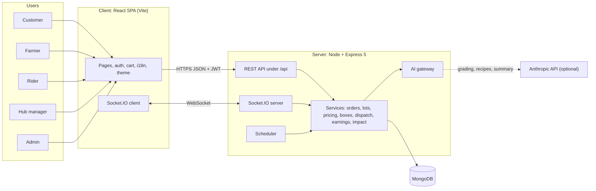
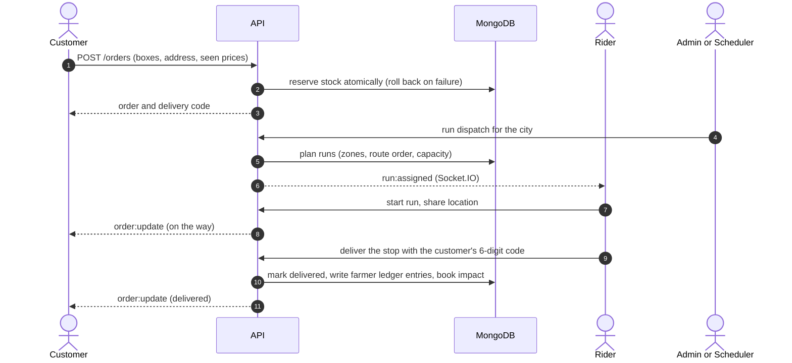
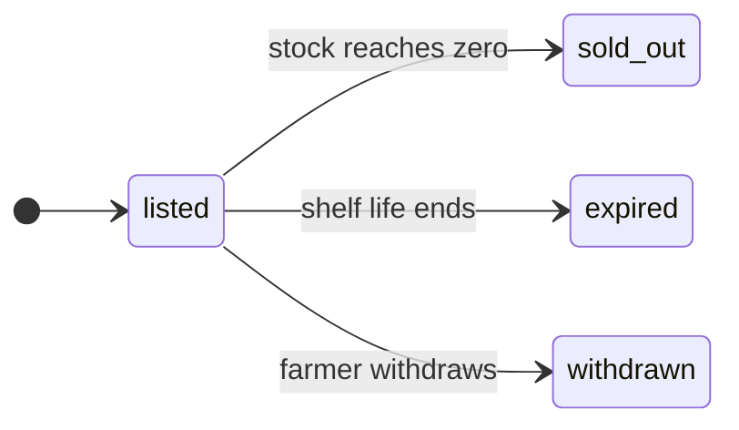
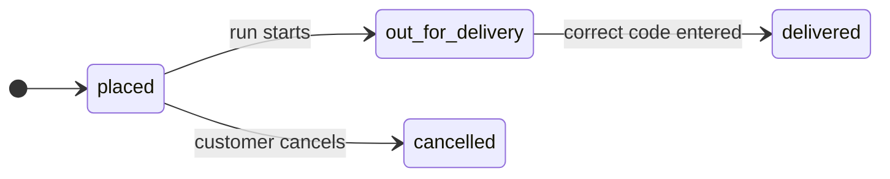
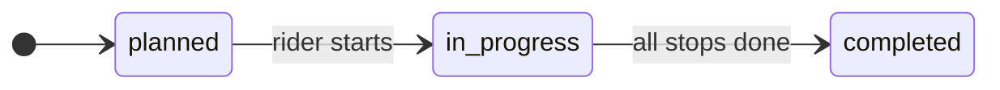
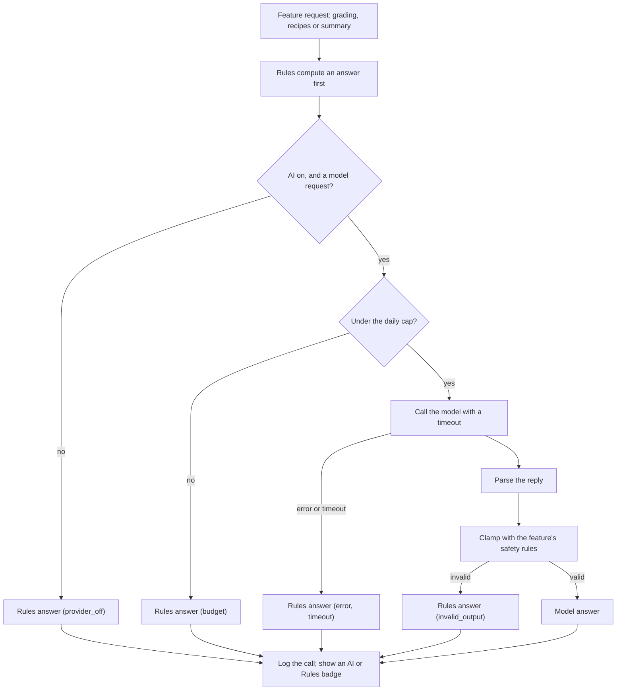
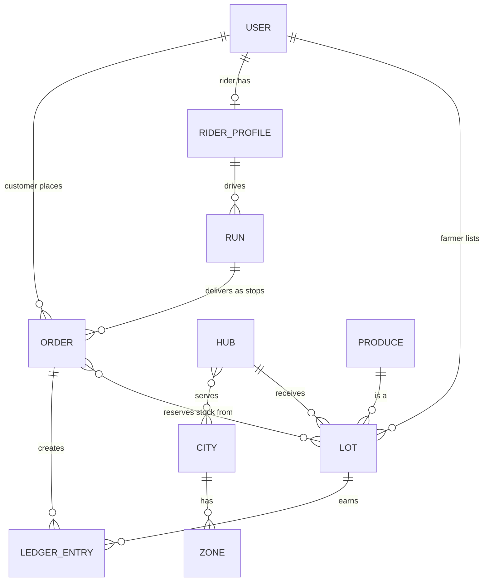
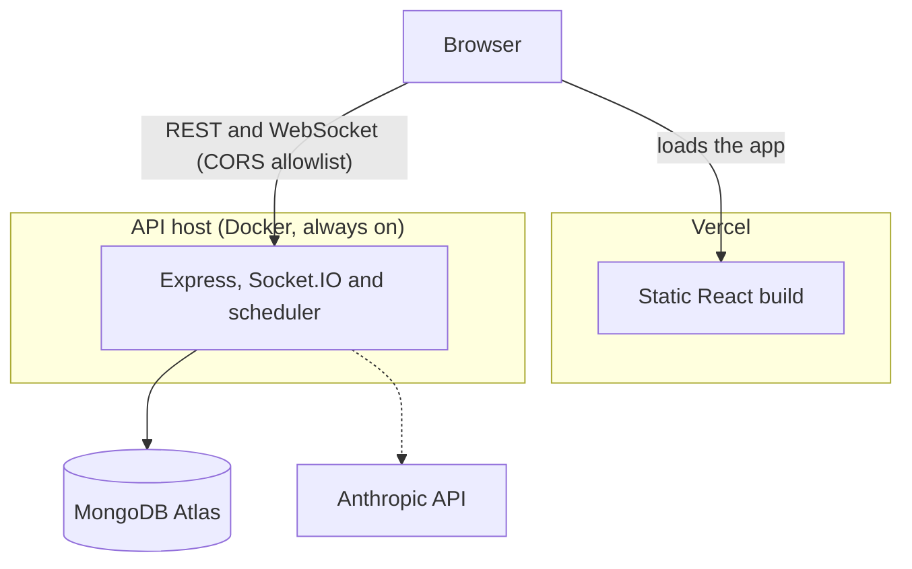

# Haatly (হাটলি)

**Bent vegetables, straight prices.** _(বাঁকা সবজি, সোজা হিসাব)_

Haatly is a produce-rescue marketplace for Bangladesh. Farmers list surplus and cosmetically imperfect produce, prices fall as shelf life runs down, shoppers buy mixed boxes at a discount, and riders deliver them in routed runs. The farmer always gets at least their floor price. _Haat_ (হাট) is the traditional village market; Haatly is a smarter one.

It launches with two cities, Dhaka and Chattogram, and is Bangla-first with an English toggle.

## Contents

[How it works](#how-it-works) · [Features](#features) · [Architecture](#architecture) · [Tech stack](#tech-stack) · [Project structure](#project-structure) · [Getting started](#getting-started) · [Configuration](#configuration) · [AI](#ai-optional) · [Testing and CI](#testing-and-ci) · [Docker](#docker) · [Deployment](#deployment) · [Security](#security) · [API](#api) · [Contributing](#contributing) · [Known limits](#known-limits)

## How it works

1. **Farmers list produce.** They pick the crop, quantity and drop-off hub, tick visible defects and optionally add a photo. The system grades it and sets a shelf life. Rot and mould are never sellable.
2. **Prices follow the clock.** The less time left, the lower the price, never below the farmer's floor. The floor applies to the payout, not just the shelf price.
3. **Shoppers buy boxes.** Each city's shelf is built from real stock. Stock is reserved atomically at checkout, so nothing is oversold.
4. **Riders deliver in runs.** Orders are grouped by area, ordered into a short route, and delivered with a 6-digit code the customer reads out at the door.
5. **Everyone sees the result.** Customers track orders live, farmers see earnings from a ledger, and the public impact page shows food rescued.

## Features

**Customers**

- Boxes per city with price, market value and savings; box contents; cart with live repricing; checkout with cash on delivery or a wallet (sandbox).
- Order tracking with timeline, live updates and the delivery code; idempotent cancel; recipe suggestions from the box contents; an impact page with a personal summary.

**Farmers**

- Lot listing with defect tags, optional photo grading and a grade result before listing.
- Earnings from a ledger (total, unpaid, paid), a 7-day demand forecast per city, and lot withdrawal.

**Riders**

- On/off duty, runs pushed live, route map, next-stop card with call and maps links.
- Delivery with the customer's code, failure reasons, location sharing while on a run.

**Hub managers** see only their own hub: lots at a collection hub, runs at a city depot.

**Admins** get a control room: overview (rescue rate, orders, lots at risk, riders on duty, top areas), approvals, staff and hub-manager creation, rider setup, dispatch and shelf rebuild, farmer payouts, scheduled-job status and AI health.

**Platform**

- Bangla-first interface, English toggle, dark and daylight themes, mobile tab bar.
- Optional AI for photo grading, recipes and an impact summary, always with a rule-based fallback.
- Scheduled jobs for shelf building, repricing, expiry and payments, all safe to repeat.

## Architecture

### System



### An order, end to end



### Status lifecycles







### The AI gateway

Every AI feature goes through one gateway. The rules always produce an answer first, so a missing key, a timeout or a bad reply can never break a feature.



### Data model (simplified)



### Who can do what

| Role        | Gets in by                                    | Can                                                                  |
| ----------- | --------------------------------------------- | -------------------------------------------------------------------- |
| Customer    | Self-register                                 | Browse, order, track, cancel, recipes, own impact                    |
| Farmer      | Self-register, **admin approval**             | List and withdraw lots, earnings, forecast, grading                  |
| Rider       | Self-register, **admin approval and profile** | Duty, runs, deliveries, location                                     |
| Hub manager | Created by admin with a hub                   | Read their own hub only                                              |
| Admin       | Created by script                             | Everything above, plus approvals, dispatch, payouts, jobs, AI health |

### Scheduled jobs

| Job                 | When         | Does                                           |
| ------------------- | ------------ | ---------------------------------------------- |
| `shelf-morning`     | daily 05:30  | Builds the day's boxes per city                |
| `shelf-refresh`     | every 15 min | Keeps prices and units live                    |
| `lot-upkeep`        | hourly       | Expires lots and applies markdowns             |
| `payment-upkeep`    | every 5 min  | Expires unpaid orders and releases their stock |
| `earnings-backfill` | daily 02:00  | Repairs any missing ledger entries             |

Each job is safe to repeat, so a restart or double run does no harm.

## Tech stack

| Layer         | Technology                                                                     |
| ------------- | ------------------------------------------------------------------------------ |
| Server        | Node 24, Express 5, Mongoose, Socket.IO, zod, helmet, express-rate-limit, pino |
| Database      | MongoDB 8 (Atlas in production)                                                |
| Client        | React 19, Vite, Tailwind CSS 3, React Router 7, socket.io-client               |
| AI (optional) | Anthropic Messages API (default model `claude-haiku-5-5`)                      |
| Testing       | Vitest, Testing Library, in-memory MongoDB, supertest                          |
| Tooling       | ESLint, Prettier, GitHub Actions                                               |
| Delivery      | Docker, nginx, Vercel (client), Render or any Docker host (API)                |

Design: a custom theme (jute, leaf, turmeric and crate-blue palette), Tiro Bangla and Hind Siliguri fonts, dark by default with a daylight toggle.

## Project structure

```
haatly/
├── client/                 React app
│   └── src/
│       ├── api/            fetch client, useApi hook
│       ├── auth/ cart/ city/ theme/ i18n/ realtime/
│       ├── components/ pages/ lib/
│       └── routes.js       the one route table, reused for every link
├── server/
│   ├── src/
│   │   ├── config/         env validation (fails fast)
│   │   ├── routes/ schemas/ middleware/
│   │   ├── services/       ai, boxes, dispatch, earnings, forecast, impact,
│   │   │                   lots, orders, payments, pricing, recipes, routing
│   │   ├── models/ realtime/ jobs/ seed/ scripts/
│   └── tests/              unit and integration
├── docs/                   feature docs and API reference
├── .github/workflows/      CI
└── docker-compose.yml
```

## Getting started

**Needs:** Node 24 (see `.nvmrc`; the engines field allows 22.13 and up) and Docker for MongoDB.

```bash
git clone https://github.com/<you>/haatly.git && cd haatly
npm install                                  # root tooling (lint, format)
docker compose up -d mongo                   # local MongoDB

cd server
cp .env.example .env                         # then edit it (see Configuration)
npm install
npm run seed:catalog                         # cities, zones, hubs, produce
npm run dev                                  # http://localhost:5000

cd ../client
npm install
npm run dev                                  # http://localhost:5173
```

Generate a secret for `JWT_SECRET` in `server/.env`:

```bash
node -e "console.log(require('crypto').randomBytes(48).toString('base64url'))"
```

**First admin.** Add `ADMIN_NAME`, `ADMIN_EMAIL`, `ADMIN_PHONE` and `ADMIN_PASSWORD` (10+ characters) to `server/.env`, run `npm run admin:create`, then delete those four lines.

**Try the whole flow**

1. Register a farmer and a rider; approve both under Admin → Approvals.
2. Admin → Riders: give the rider a city, vehicle and zones. Admin → Staff: create a hub manager.
3. As the farmer, list lots, then Admin → Overview → Rebuild shelf.
4. As a customer, order a box. Admin → Overview → Run dispatch.
5. As the rider, go on duty, start the run, deliver with the customer's code.

## Configuration

### Server (`server/.env`)

| Variable               | Purpose                                                       | Default            |
| ---------------------- | ------------------------------------------------------------- | ------------------ |
| `NODE_ENV`             | `development`, `test` or `production`                         | `development`      |
| `PORT`                 | API port                                                      | `5000`             |
| `MONGODB_URI`          | Database connection string (name the database)                | required           |
| `CLIENT_ORIGINS`       | Allowed browser origins for CORS and sockets, comma-separated | required           |
| `JWT_SECRET`           | Token signing secret; production refuses placeholders         | required           |
| `JWT_EXPIRES_IN`       | Token lifetime                                                | `7d`               |
| `TRUST_PROXY`          | Number of proxies in front (use `1` behind Render or nginx)   | `0`                |
| `ENABLE_SCHEDULER`     | Run the scheduled jobs in this process                        | see `.env.example` |
| `PAYMENT_PROVIDER`     | `sandbox` for development, `none` in production               | see `.env.example` |
| `AI_PROVIDER`          | `none` or `anthropic`                                         | `none`             |
| `ANTHROPIC_API_KEY`    | Required when `AI_PROVIDER=anthropic`                         | empty              |
| `AI_MODEL`             | Model name                                                    | `claude-haiku-5-5` |
| `AI_TIMEOUT_MS`        | Per-call timeout                                              | `15000`            |
| `AI_MAX_CALLS_PER_DAY` | Hard daily cap on model calls                                 | `500`              |
| `LOG_LEVEL`            | pino level                                                    | `debug`            |

### Client (`client/.env`)

| Variable       | Purpose                                                                                                                            |
| -------------- | ---------------------------------------------------------------------------------------------------------------------------------- |
| `VITE_API_URL` | The API's public origin in production (no trailing slash). Leave empty in development, where Vite proxies `/api` and `/socket.io`. |

## AI (optional)

Everything works with `AI_PROVIDER=none`. Turning it on adds:

- **Photo grading:** the model is asked only when a photo is attached, and may only _add_ defects. A farmer's ticked defects are never removed, and rot, mould and slime always block a sale. The photo is graded and discarded, never stored.
- **Recipe suggestions:** on request, from the box contents.
- **Impact summary:** the model writes only the wording, with placeholders. It never sees customer data, and the numbers are filled in by code.

Safety rules: model output is parsed and clamped by each feature before use; anything invalid falls back to the rules; a daily call cap applies. The UI shows an **AI** or **Rules** badge, and Admin → AI shows per-feature calls, fallbacks and reasons, latency and tokens. Pricing, box building, routing and the forecast are deliberately deterministic.

## Testing and CI

```bash
npm run lint && npm run format:check         # repo root
npm test --prefix server                     # unit + integration, in-memory MongoDB
npm test --prefix client
npm run build --prefix client
```

More than a thousand server tests cover the money rules, stock reservation, dispatch, realtime and access control. Integration tests start a temporary MongoDB per file and run one file at a time. If they crash on Windows with `spawn UNKNOWN` or `fassert`, stop stray `mongod` processes and close memory-hungry apps.

GitHub Actions runs lint and format, server tests, client tests and build, and Docker image builds on every push and pull request.

## Docker

```bash
# .env next to docker-compose.yml: JWT_SECRET=<48+ random characters>
# (optional: AI_PROVIDER, ANTHROPIC_API_KEY, AI_MODEL, AI_MAX_CALLS_PER_DAY)
docker compose --profile app up --build -d
docker compose --profile app run --rm server node src/scripts/seedCatalog.js
```

Open http://localhost:8080 (nginx serves the client and proxies `/api` and `/socket.io`). Wallet payments are off in this mode; cash on delivery works. `docker compose up -d mongo` alone starts just the database for development.

## Deployment



- **Client on Vercel:** root directory `client`, set `VITE_API_URL`, and `client/vercel.json` provides the single-page-app rewrite.
- **API on a Docker host** such as Render: root directory `server`, health check `/api/health`, `TRUST_PROXY=1`, `CLIENT_ORIGINS` set to the exact Vercel origin. Vercel itself can't host the API, because the server needs long-lived WebSockets and an in-process scheduler.
- **Database:** a production Atlas user with read/write on one database, and a connection string that names the database.
- **Simplest alternative:** the compose file above on a single VPS, with no CORS to configure.

## Security

- Roles are enforced on the server; farmers and riders must be approved before they can act.
- Production refuses placeholder secrets and the sandbox payment provider.
- Hub managers can only read their own hub, taken from their account rather than the request.
- Delivery codes are derived, never stored, and are hidden from riders.
- CORS allowlist, security headers, and rate limits on auth, grading and the API generally.
- Sockets require a valid token; location payloads are validated and rate-limited.
- AI output is never trusted as it arrives (see [AI](#ai-optional)).

Never commit `.env` files. If a secret leaks, rotate it.

## API

Base path `/api`, bearer-token auth, errors as `{ "error": { "code", "message", "details" } }`. Full reference in [`docs/API.md`](docs/API.md). Feature deep-dives are in `docs/`: AI, BOXES, DISPATCH, EARNINGS, FORECAST, JOBS, ORDERS, PAYMENTS, PRICING, REALTIME and RECIPES.

## Contributing

- Branch per change: `feat/…`, `fix/…`, `build/…`, `docs/…`, merged into `main` by pull request.
- Commit messages use `type(scope): message`, for example `feat(client): add forecast panel`.
- Before every commit: `npm run format && npm run lint`, and run the tests for the folder you changed.
- Releases are tagged `vX.Y.Z` from `main`; the changelog is in [`CHANGELOG.md`](CHANGELOG.md).

## Known limits

- Impact figures are estimates; routing uses zone centres, not street addresses.
- Payments are sandbox-only until a real gateway is added.
- No monthly impact email yet.
- Stock can stay reserved if the server stops mid-checkout or mid-cancel; a reconciliation job is planned.
- The public "hub floor" board of live lots is planned.

## License

See [`LICENSE`](LICENSE).
